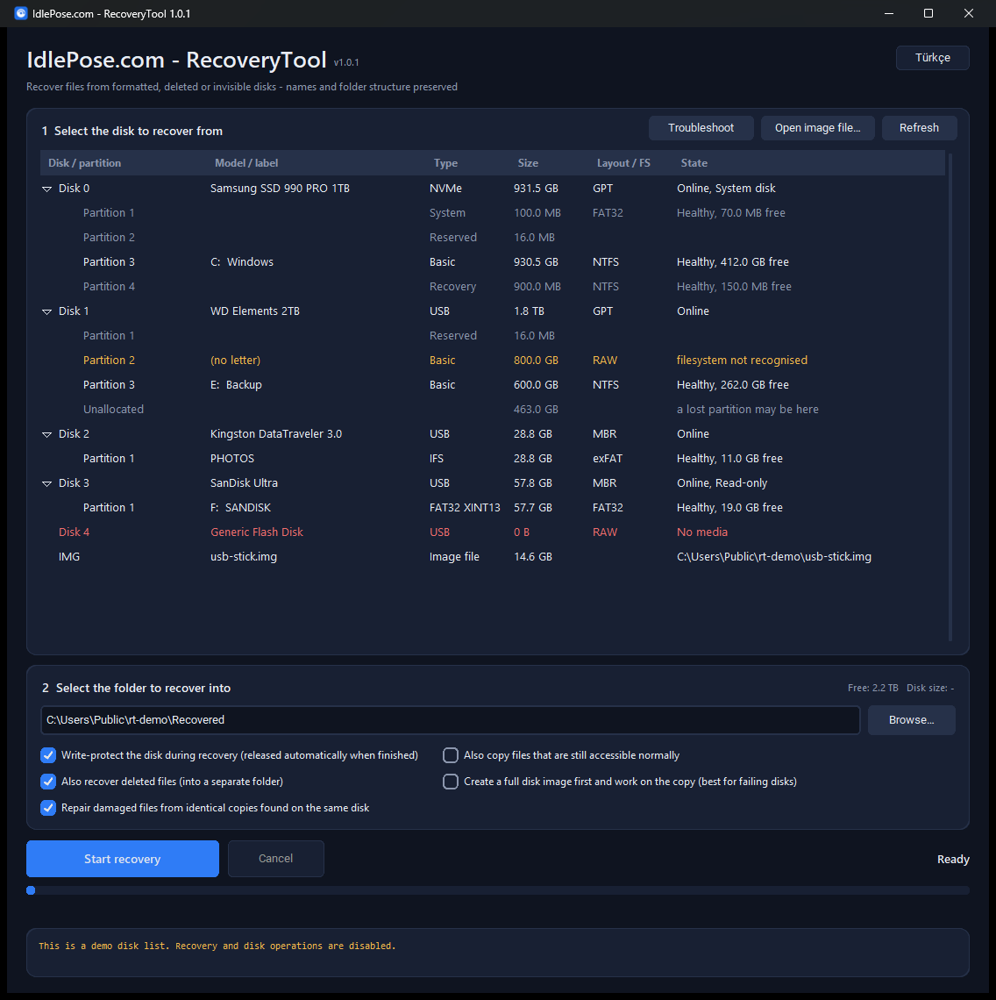
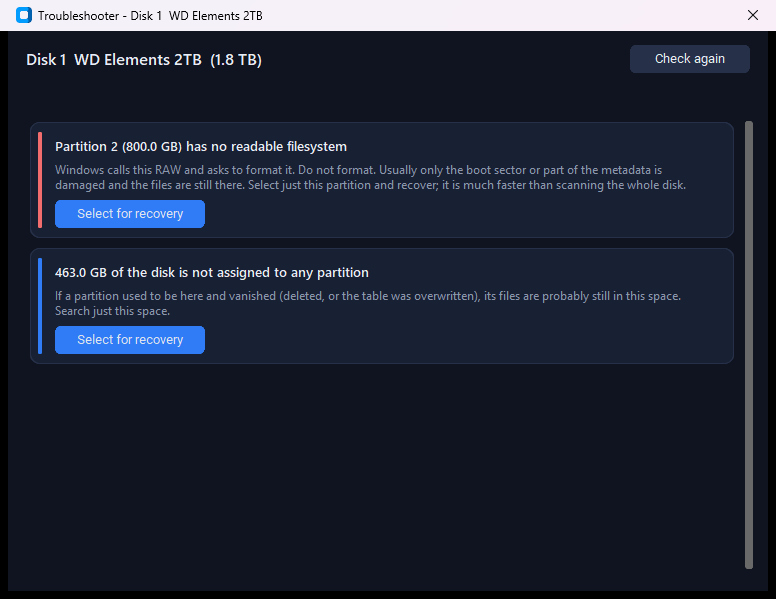

# IdlePose.com - Benchwise

By [IdlePose.com](https://idlepose.com). A free, open-source workbench of tools for your disks, hardware and
Windows. The window shows categories as big cards (Disk, System & Memory, Battery & Power, Display & Input,
Network, Windows Repair, Cleanup & Privacy); each holds its tools. Tools that need administrator rights are
marked with a shield and ask for them only when you open one.

The first tool, **File Recovery** (formerly RecoveryTool), gets files back from **formatted**, **deleted** or
**invisible** disks with their **original names and folder structure**. The other tools are on the way;
their cards say "Coming soon".

The rest of this page describes File Recovery.

[Türkçe açıklama aşağıda](#türkçe)



## What it does

- Lists **every disk with its partitions and unallocated space**, the way Disk Management does,
  including disks that have no drive letter, are offline, or show up as RAW.
- Recovers from a **whole disk, a single partition, or a stretch of unallocated space**. Picking
  just the partition you lost is much faster than scanning the whole disk.
- **Scans first, then lets you choose.** The scan writes nothing and lists everything it found as
  a folder tree with tick boxes. You recover what you tick, as often as you like.
- **Does not need room for everything at once.** If the destination fills up, whatever fitted is
  kept and the rest stays ticked. Move the recovered files away, or pick another folder, and carry
  on. Recovered files show a **green check mark**, files not recovered yet a **grey ring**.
- **Every scan is saved.** Close the program and come back next week: "Saved scans" opens the list
  again, with the state of every file, without scanning the disk a second time.
- **Pause and continue** at any moment. A scan that is stopped half-way continues from where it
  was, even after the program was closed.
- **Live panel** next to the main window: progress, speed with a graph, time left, what the scan
  has found so far, per-status counts, free space in the destination, the last files written.
- **Write-protects the source disk** for the duration of the recovery and removes the protection
  again when it finishes, is cancelled, or fails. The source is only ever opened for reading.
- Rebuilds the folder tree of **FAT32, exFAT and NTFS** volumes from what is still on the disk:
  after a quick format, after files were deleted, when a partition vanished from the partition
  table, or after an installer image was written over the disk by mistake. The geometry of a lost
  volume is derived from the data itself, so no boot sector is needed.
- Restores names (long and Unicode), folder structure, timestamps and attributes.
- **Tells you the truth about every file.** Each file gets a status and a SHA-256 in the report.
  Files whose space was overwritten by a new filesystem or by a written image are detected and
  marked, not silently handed over as if they were fine.
- **Repairs from identical copies**: if a damaged file has an intact twin elsewhere on the same
  disk (backup folders are common), the damaged blocks are refilled from it.
- **Troubleshooter**: explains what is wrong with a disk in plain words, fixes what software can
  fix (offline disk, leftover write protection, missing drive letter) and says clearly when
  nothing can be done.
- **Right-click a disk or partition** for the everyday operations: assign, change or remove a
  drive letter, bring a disk online or take it offline, set or clear read-only, check or repair
  the filesystem, open in Explorer, properties.
- Can work on a **disk image** instead of the disk, and can create that image first, which is the
  safe way to handle a failing disk.
- Portable: one `.exe`, nothing to install, no Python needed. English and Turkish interface.


## Download and use

1. Download `Benchwise.exe` from the Releases page and run it. Open **Disk > File Recovery**; it
   asks to restart Benchwise as administrator, because reading raw disks requires it.
2. Select the disk you lost data on, or open it and select just the partition or the unallocated
   space where the data was.
3. Press **Start scan**. Nothing is written anywhere yet. **Pause** and **Stop** are next to it; a
   stopped scan can be continued later.
4. When the scan is done the files are listed. Tick the folders and files you want (everything is
   ticked to begin with), choose a destination folder **on a different disk**, and press
   **Recover ticked files**.
5. Not enough room? Recover anyway: what fits is written and marked green, the rest stays ticked.
   Move the recovered files elsewhere or choose another folder and press the button again. You
   can also close the program and continue another day from **Saved scans**.

The total a scan reports can be larger than the disk itself: deleted files whose space was reused
and old copies of the same file each count in full. That is why you choose, instead of having to
find that much free space.

Stop using the disk you lost data on as soon as you notice the loss. Every write to it can
destroy something that was still recoverable. Do not let Windows "initialise" or "format" it.

### Which row to select

| Situation | Select |
|---|---|
| Files deleted from a drive that still works | that partition |
| Partition shows as RAW / "you need to format" | that partition |
| Drive was formatted | that partition |
| A partition disappeared; there is unallocated space where it was | the unallocated row |
| An image (ISO, installer) was written over the disk, or the layout is unknown | the whole disk |

Files that Windows can still open normally are left out by default; tick "Also copy files that
are still accessible normally" if you want them too. A partition counts as accessible only when
Windows recognises its filesystem, so a lost or RAW partition is always recovered.

### What you get

```
<destination>\
  Volume 1 - FAT32 - LABEL\              the recovered tree, exactly as it was
  Volume 1 - FAT32 - LABEL (deleted)\    files that had been deleted earlier, original paths
  Volume 1 - FAT32 - LABEL (orphaned)\   folders whose parent folder no longer exists
  RecoveryTool-Report\
      report.csv            every file: path, size, date, status, details, SHA-256
      needs-attention.txt   everything that is not OK
      summary.txt
```

Every recovery run writes its own report folder. A file that was ticked but did not fit is listed
as `NOT_RECOVERED` and is still waiting in the saved scan.

| Status | Meaning |
|---|---|
| `OK` | Recovered intact. |
| `REPAIRED` | Damaged blocks were refilled from a copy whose remaining blocks matched byte for byte. |
| `FILLED_FROM_TWIN` | Completely overwritten; replaced by a copy with the same name, size and timestamp (content could not be compared). |
| `UNCERTAIN` | Recovered, but integrity cannot be proven: a deleted file, a cluster layout that had to be guessed, or a file lying under a partition this tool cannot look into (`MAYBE_OVERWRITTEN`). |
| `DAMAGED` | There is evidence of corruption; the details column says what (`OVERWRITTEN:bytes/size`, `CONTENT_MISMATCH`, `ARCHIVE_CRC_ERROR`, `READ_ERROR`, …). |
| `UNSUPPORTED` | NTFS-compressed file (not implemented yet). |
| `SKIPPED` | Nothing usable was left. |

## Troubleshooter and disk operations



Select a disk and press **Troubleshoot**. It looks at what Windows reports and at the disk's
reliability counters, and lists what it finds:

| Finding | What the tool offers |
|---|---|
| Disk is offline | bring it online |
| Disk is write-protected (for example after an interrupted run) | remove the protection |
| Partition has a good filesystem but no drive letter | assign one |
| Volume reported unhealthy | read-only filesystem check |
| Partition is RAW, no partition table, or unallocated space where a partition used to be | select exactly that region for recovery |
| Uncorrectable I/O errors, failing health, worn-out flash | recover with the image option; replace the disk |
| Device shows 0 bytes / "No media" | nothing: this is a hardware or firmware fault, and the tool says so |

The same operations are in the right-click menu. Two rules are built in:

- There is **no** format, initialise, delete-partition or partition-table repair. Those destroy
  data and do not belong in a recovery tool.
- **Repair filesystem** (Windows chkdsk) writes to the volume and can delete damaged files while
  fixing things. The tool warns about this every time: recover first, repair afterwards.

## What it cannot do

Be clear about these before relying on it:

- **SSDs with TRIM.** When a file is deleted or a volume is formatted on an SSD, Windows tells
  the drive to discard the data and the drive returns zeros afterwards. No software can recover
  that. USB sticks, SD cards and hard disks generally do not trim.
- **Full (non-quick) format** and **overwritten data** are gone. An image written over a disk
  destroys everything under it; what lies beyond the end of the image is still there.
- A new filesystem always overwrites the beginning of the old one's metadata. NTFS formatted over
  NTFS loses the first 256 file records; a format over FAT32/exFAT can lose the root folder's
  names. Affected folders appear under `(orphaned)` with placeholder names; their contents are
  intact.
- After FAT32 is formatted as FAT32 again the allocation table is wiped, so fragmented files
  cannot be reassembled. They are marked `UNCERTAIN` or `DAMAGED`, never `OK`.
- If the disk now holds ext4, XFS, btrfs, HFS+, APFS or similar, the tool cannot tell which
  blocks that filesystem uses. Old files under it are marked `UNCERTAIN`.
- Not supported yet: FAT12/FAT16, ReFS, BitLocker-encrypted volumes, NTFS-compressed files, RAID
  reconstruction, raw "file carving" by signature without filesystem metadata.
- Physically failing disks need a professional lab. If the disk clicks or disappears, stop.

## How it works

1. **Lock** the disk read-only (`Set-Disk -IsReadOnly`).
2. **Scan** the selected disk, partition or region once, recording where filesystem metadata
   lives: boot sectors (primary and backup), FAT directory clusters, NTFS file records, exFAT
   directory entry sets.
3. **Rebuild** each filesystem:
   - *FAT32*: every sub-directory stores its own cluster number in its `.` entry; a few
     directories are enough to solve for cluster size and data-area offset. The FAT copies are
     then located in front of the data area and the tree is walked.
   - *exFAT*: each entry set is placed by the cluster it physically sits in. Without a boot
     sector, geometry is voted from directory positions and confirmed against file signatures.
   - *NTFS*: every file record is decoded on its own and the tree is rebuilt from parent
     references, including deleted records and records left over from before a format.
4. **Map what is on the disk now**: the space the current NTFS/FAT32/exFAT filesystems occupy,
   the extent of an ISO image written to the start of the disk, and partitions holding something
   the tool cannot read. Any old file overlapping these is damaged, or possibly damaged, in
   exactly those bytes.
5. **Save the catalogue** of everything found as a scan file and **unlock** the disk. Nothing has
   been written to the destination so far.
6. For the files the user ticks, with the disk locked again: **extract** each one to the
   destination, hashing as it goes, restore timestamps and attributes, then **verify** it at
   once: read it back, test ZIP-based documents (docx/xlsx/…) by CRC, compare the content against
   the file type's signature. Its outcome is recorded in the scan file before the next file
   starts. A file that does not fit into the free space is skipped and stays pending.
7. **Repair from twins**, write the **report** of this run, **unlock** the disk. Step 6 and 7
   can be repeated for other files or another destination at any time.

## Run from source

Setup, the command line, building the exe and cutting a release are covered in
[BUILDING.md](BUILDING.md) (English and Turkish). The short version:

```powershell
git clone https://github.com/ferhat37ozkan/RecoveryTool.git
cd RecoveryTool
py -3.12 -m venv .venv
.\.venv\Scripts\pip install -r requirements.txt
.\.venv\Scripts\python run.py        # from an elevated prompt
.\build.ps1                          # writes dist\Benchwise.exe
```

### Code map

| File | Role |
|---|---|
| `disks.py` | Disk and partition enumeration, write-protection, drive letters, filesystem check |
| `troubleshoot.py` | Turns what Windows reports about a disk into findings and suggested fixes |
| `source.py` | Read-only access to a disk, a partition window or an image; unreadable sectors become zeros and are counted |
| `scanner.py` | Single-pass metadata scan |
| `fat32.py`, `exfat.py`, `ntfs.py` | Filesystem reconstruction |
| `allocation.py` | Current partition table and what currently occupies the disk (overwrite detection) |
| `engine.py` | Pipeline: scan and catalogue; then extract, verify, repair, report for the chosen files |
| `session.py` | Saved scans (SQLite): the catalogue and what has been recovered; checkpoints of interrupted scans |
| `catalog.py` | The catalogue as a folder tree with tick boxes and per-folder counters (model of the result browser) |
| `signatures.py` | File-type signatures |
| `gui.py`, `icons.py`, `cli.py`, `i18n.py` | Interfaces, row icons and translations |

## Tests

| Test | Needs | Covers |
|---|---|---|
| `tests\test_source.py` | nothing | reading from a failing disk: bad sectors, unplugged device |
| `tests\test_troubleshoot.py` | nothing | disk layout, troubleshooter findings, translations; uses a made-up disk list |
| `tests\test_layouts.py` | nothing; more with a disk image | MBR/GPT parsing, lost partitions, single-partition recovery, an image written over a disk |
| `tests\test_session.py` | nothing; more with a disk image | pause and stop, continuing an interrupted scan, saved scans, a destination that is too small, recovering in several goes |
| `tests\test_scenarios.py` | administrator, diskpart | real filesystems in virtual disks, destroyed and recovered, checked against original hashes |

The property the scenario suite enforces: **a file reported `OK` or `REPAIRED` is byte-identical
to the original.** Results of the last full run (version 1.0.2):

| Scenario | Recovered | False `OK` |
|---|---|---|
| FAT32 → NTFS format | 96 % | 0 |
| FAT32 → FAT32 format | 96 % | 0 |
| FAT32 → exFAT format | 100 % | 0 |
| exFAT → exFAT format | 96 % | 0 |
| exFAT → NTFS format | 100 % | 0 |
| NTFS → NTFS format | 100 % | 0 |
| NTFS → exFAT format | 100 % | 0 |
| FAT32 / exFAT / NTFS deleted files | 100 % | 0 |

These are small synthetic disks with a filler that absorbs the metadata a new filesystem always
overwrites; real-world rates depend on how much was written to the disk after the loss.

Note: the scenario suite attaches and detaches virtual disks many times in a row. Run it on a
machine you can afford to reboot; a buggy storage driver can react badly to that. The application
itself never attaches virtual disks.

What has **not** been tested on real hardware yet: the disk operations in the right-click menu
and the troubleshooter's fixes (they call the standard Windows storage cmdlets), and recovery
from a multi-partition physical disk. They were developed against image files and a made-up disk
list. Reports from real disks are welcome.

## If a run is interrupted

Nothing is lost. Files are finished one at a time and recorded in the saved scan as they are
written, so after a crash the scan opens with everything up to that point marked as recovered.
A scan that did not finish continues from its last checkpoint (taken every 20 seconds) when the
same disk is scanned again. Scans live in `%LOCALAPPDATA%\RecoveryTool`, never on the disk
that is being recovered.

If the computer loses power or crashes mid-recovery, the source disk stays write-protected.
RecoveryTool remembers this (by disk serial number) and offers to remove the protection the next
time it starts with that disk connected. You can also right-click the disk and choose "Remove
read-only", run `python -m benchwise --unlock-pending`, or do it by hand in an elevated
PowerShell: `Set-Disk -Number <n> -IsReadOnly $false`.

## Contributing

Issues and pull requests are welcome. If recovery fails on your disk, the most useful report is
the output of `python tests\inspect_image.py <image>` (it prints structure counts, no file
contents). Please do not attach disk images that contain personal data.

To work on the interface without touching any disk, point `RECOVERYTOOL_FAKE_DISKS` at
`docs\demo-disks.json`; see [BUILDING.md](BUILDING.md).

## Disclaimer and license

MIT License, see [LICENSE](LICENSE). The software is provided without warranty. It never writes
to the source disk during recovery, but no recovery tool can guarantee a result. For
irreplaceable data on a physically damaged disk, consult a professional recovery service first.

---

# Türkçe

**IdlePose.com - Benchwise** — diskleriniz, donanımınız ve Windows için ücretsiz, açık kaynak bir araç
tezgâhı. Pencere kategorileri büyük kartlar halinde gösterir (Disk, Sistem ve Bellek, Pil ve Güç, Ekran ve
Giriş, Ağ, Windows Onarımı, Temizlik ve Gizlilik); her kategorinin içinde kendi araçları vardır. Yönetici
yetkisi isteyen araçlar kalkanla işaretlidir ve yetkiyi yalnızca açıldıklarında sorar.

İlk araç **Dosya Kurtarma** (eski adıyla RecoveryTool), **biçimlendirilmiş**, **silinmiş** veya Windows'ta
**görünmeyen** disklerdeki dosyaları **özgün adları ve klasör yapısıyla** geri getirir. Diğer araçlar yolda;
kartlarında "Yakında" yazar.

Bu sayfanın geri kalanı Dosya Kurtarma'yı anlatır.

## Neler yapar

- **Tüm diskleri bölümleri ve ayrılmamış alanlarıyla** Disk Yönetimi'ndeki gibi listeler: sürücü
  harfi olmayan, çevrimdışı veya RAW görünen diskler dahil.
- **Diskin tamamından, tek bir bölümden ya da ayrılmamış bir alandan** kurtarır. Yalnızca
  kaybettiğiniz bölümü seçmek, tüm diski taramaktan çok daha hızlıdır.
- **Önce tarar, sonra seçtirir.** Tarama hiçbir şey yazmaz; bulduğu her şeyi onay kutulu bir
  klasör ağacı olarak listeler. İşaretlediklerinizi, istediğiniz kadar seferde kurtarırsınız.
- **Her şeye aynı anda yer gerekmez.** Hedef dolarsa sığanlar kalır, sığmayanlar seçili bekler.
  Kurtarılanları başka yere taşıyın ya da başka klasör seçin ve devam edin. Kurtarılan dosyalarda
  **yeşil onay işareti**, henüz kurtarılmayanlarda **gri halka** görünür.
- **Her tarama kaydedilir.** Programı kapatıp haftaya dönün: "Kayıtlı taramalar" listeyi her
  dosyanın durumuyla birlikte, diski yeniden taramadan açar.
- **Duraklat ve devam et**: istediğiniz anda. Yarıda durdurulan tarama, program kapatılmış olsa
  bile kaldığı yerden sürer.
- **Canlı panel**: ilerleme, grafikli hız, kalan süre, taramanın o ana dek buldukları, duruma göre
  dosya sayıları, hedefteki boş alan, son yazılan dosyalar. Bir düğmeyle gizlenir ve açılır.
- Kurtarma süresince **kaynak diski yazmaya karşı kilitler**; işlem bitince, iptal edilince veya
  hata verince kilidi kendisi kaldırır. Kaynak yalnızca okunur.
- **FAT32, exFAT ve NTFS** birimlerinin klasör ağacını diskte kalan izlerden yeniden kurar: hızlı
  biçimlendirme sonrası, dosyalar silindikten sonra, bölüm tablodan kaybolduğunda ya da diskin
  üzerine yanlışlıkla bir kurulum imajı yazıldığında.
- Adları (uzun ve Türkçe karakterli), klasör yapısını, tarihleri ve öznitelikleri geri yükler.
- **Her dosya için doğruyu söyler.** Raporda her dosyanın durumu ve SHA-256 özeti bulunur. Yeni
  dosya sisteminin ya da yazılan imajın ezdiği dosyalar tespit edilip işaretlenir.
- **Özdeş kopyadan onarım**: hasarlı bir dosyanın aynı diskte sağlam bir kopyası varsa hasarlı
  bloklar ondan doldurulur.
- **Sorun giderici**: diskte neyin yanlış olduğunu sade bir dille açıklar, yazılımla
  düzeltilebilenleri düzeltir (çevrimdışı disk, açık kalmış yazma koruması, eksik sürücü harfi),
  düzeltilemeyenleri açıkça söyler.
- **Disk ya da bölüme sağ tıklayarak**: sürücü harfi atama, değiştirme, kaldırma; çevrimiçi /
  çevrimdışı yapma; salt okunuru açıp kapatma; dosya sistemini denetleme ya da onarma; Gezgin'de
  açma; özellikler.
- Disk yerine **disk imajı** üzerinde çalışabilir; istenirse önce imajı kendisi alır.
- Taşınabilir: tek `.exe`, kurulum yok, Python gerekmez. Türkçe ve İngilizce arayüz.

## Kullanım

1. Releases sayfasından `Benchwise.exe` dosyasını indirip çalıştırın. **Disk > Dosya Kurtarma**'yı
   açın; ham diskleri okuyabilmek için Benchwise'ı yönetici olarak yeniden başlatmayı önerir.
2. Veri kaybettiğiniz diski seçin; ya da diski açıp yalnızca verinin bulunduğu bölümü veya
   ayrılmamış alanı seçin.
3. **Taramayı başlat**'a basın. Bu aşamada hiçbir yere bir şey yazılmaz. Yanında **Duraklat** ve
   **Durdur** vardır; durdurulan tarama sonra kaldığı yerden sürdürülebilir.
4. Tarama bitince dosyalar listelenir. İstediğiniz klasör ve dosyaları işaretleyin (başlangıçta
   hepsi işaretlidir), **başka bir diskte** bir hedef klasör seçin ve **Seçilenleri kurtar**'a
   basın.
5. Yer yetmiyor mu? Yine de başlatın: sığanlar yazılıp yeşil işaretlenir, kalanlar seçili bekler.
   Kurtarılanları başka yere taşıyın ya da başka klasör seçip düğmeye yeniden basın. Programı
   kapatıp başka bir gün **Kayıtlı taramalar**'dan da devam edebilirsiniz.

Taramanın bildirdiği toplam, diskin kendisinden büyük olabilir: yeri yeniden kullanılmış silinmiş
dosyalar ve aynı dosyanın eski kopyaları ayrı ayrı sayılır. Bu yüzden o kadar boş yer aramak
yerine neyi kurtaracağınızı siz seçersiniz.

Veri kaybını fark ettiğiniz anda o diski kullanmayı bırakın. Windows "diski başlat" ya da
"biçimlendir" derse kabul etmeyin.

### Hangi satırı seçmeli

| Durum | Seçilecek satır |
|---|---|
| Çalışan bir sürücüden dosya silindi | o bölüm |
| Bölüm RAW görünüyor / "biçimlendirmeniz gerekiyor" diyor | o bölüm |
| Sürücü biçimlendirildi | o bölüm |
| Bir bölüm kayboldu; yerinde ayrılmamış alan var | ayrılmamış alan satırı |
| Diskin üzerine imaj (ISO, kurulum) yazıldı ya da düzen bilinmiyor | diskin tamamı |

Windows'un hâlâ normal açabildiği dosyalar varsayılan olarak kopyalanmaz; isterseniz "Hâlâ normal
erişilebilen dosyaları da kopyala" kutusunu işaretleyin. Bir bölüm ancak Windows dosya sistemini
tanıyorsa erişilebilir sayılır; kayıp ya da RAW bölüm her zaman kurtarılır.

### Durum kodları

| Durum | Anlamı |
|---|---|
| `OK` | Eksiksiz kurtarıldı. |
| `REPAIRED` | Hasarlı bloklar, kalan blokları bayt bayt eşleşen bir kopyadan dolduruldu. |
| `FILLED_FROM_TWIN` | Tamamen ezilmişti; adı, boyutu ve tarihi aynı olan kopya yerine kondu (içerik karşılaştırılamadı). |
| `UNCERTAIN` | Kurtarıldı ama bütünlüğü kanıtlanamıyor: silinmiş dosya, tahmini yerleşim ya da aracın içine bakamadığı bir bölümün altında kalan dosya. |
| `DAMAGED` | Bozulma kanıtı var; ayrıntı sütunu nedenini yazar. |
| `UNSUPPORTED` | NTFS sıkıştırılmış dosya (henüz desteklenmiyor). |
| `SKIPPED` | Kullanılabilir veri kalmamış. |

## Sorun giderici ve disk işlemleri

Bir disk seçip **Sorun giderici**'ye basın. Windows'un bildirdiklerine ve diskin sağlık
sayaçlarına bakar, bulduklarını listeler: çevrimdışı diski çevrimiçi yapar, açık kalmış yazma
korumasını kaldırır, harfi olmayan sağlam bölüme harf atar, RAW bölüm ya da kayıp bölüm için tam o
alanı kurtarmaya seçer. Aygıt 0 bayt ya da "Ortam yok" gösteriyorsa bunun donanım arızası
olduğunu ve yazılımla düzeltilemeyeceğini açıkça söyler.

İki kural yerleşiktir:

- Biçimlendirme, disk başlatma, bölüm silme ve bölüm tablosu onarma **yoktur**. Bunlar veri yok
  eder ve bir kurtarma aracında yeri yoktur.
- **Dosya sistemini onar** (Windows chkdsk) birime yazar ve düzeltirken hasarlı dosyaları
  silebilir. Araç her seferinde uyarır: önce kurtarın, sonra onarın.

## Yapamadıkları

- **TRIM destekli SSD'ler.** SSD'de dosya silindiğinde veya birim biçimlendirildiğinde sürücü
  veriyi gerçekten siler. Bunu hiçbir yazılım kurtaramaz. USB bellekler, SD kartlar ve klasik
  diskler genellikle TRIM yapmaz.
- **Tam biçimlendirme** ve **üzerine yazılmış veri** geri gelmez. Diske yazılan bir imaj altındaki
  her şeyi yok eder; imajın bittiği yerden sonrası durur.
- Yeni dosya sistemi, eskisinin meta verisinin başını her zaman ezer. Etkilenen klasörler
  `(orphaned)` altında geçici adlarla çıkar; içerikleri sağlamdır.
- Diskte artık ext4, XFS, btrfs, HFS+, APFS gibi bir dosya sistemi varsa araç onun hangi blokları
  kullandığını bilemez; altında kalan eski dosyalar `UNCERTAIN` olarak işaretlenir.
- Henüz desteklenmeyenler: FAT12/FAT16, ReFS, BitLocker, NTFS sıkıştırma, RAID, dosya sistemi izi
  olmadan imzaya göre ham kurtarma.
- Sağ tık menüsündeki disk işlemleri ve sorun gidericinin düzeltmeleri gerçek donanımda henüz
  denenmedi; standart Windows depolama komutlarını çağırırlar.
- Fiziksel arızalı diskler profesyonel laboratuvar işidir. Disk tıkırdıyor ya da kayboluyorsa durun.

## Kaynaktan çalıştırma ve derleme

[BUILDING.md](BUILDING.md) dosyasının Türkçe bölümünde anlatılıyor.

## Lisans

MIT. Yazılım garantisiz sunulur; kurtarma sırasında kaynak diske asla yazmaz, ancak hiçbir
kurtarma aracı sonuç garantisi veremez.
