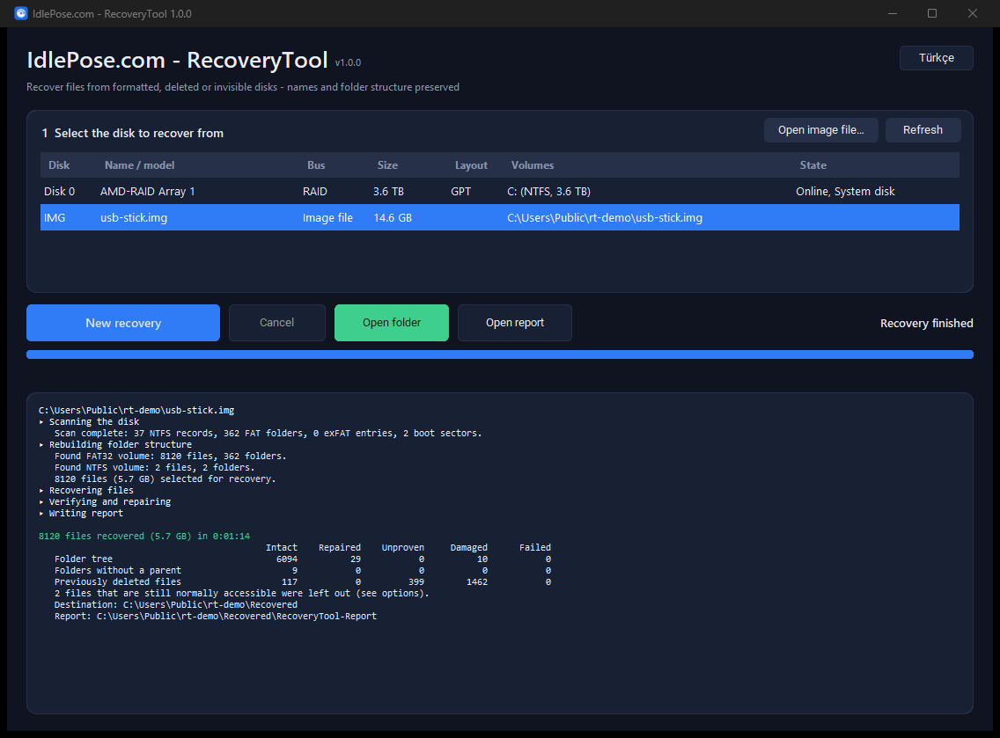

# IdlePose.com - RecoveryTool

By [IdlePose.com](https://idlepose.com). Free, open-source data recovery for Windows. Gets files back from **formatted**, **deleted** or
**invisible** disks with their **original names and folder structure**.

[Türkçe açıklama aşağıda](#türkçe)


## What it does

- Lists **every disk** the way Disk Management does, including disks that have no drive letter,
  are offline, or show up as RAW.
- **Write-protects the source disk** for the duration of the recovery and removes the protection
  again when it finishes, is cancelled, or fails. The source is only ever opened for reading.
- Rebuilds the folder tree of **FAT32, exFAT and NTFS** volumes from what is still on the disk:
  after a quick format, after files were deleted, or when the partition table / boot sector is
  gone. The geometry of a lost volume is derived from the data itself, so no boot sector is needed.
- Restores names (long and Unicode), folder structure, timestamps and attributes.
- **Tells you the truth about every file.** Each file gets a status and a SHA-256 in the report.
  Files whose space was overwritten by the new filesystem are detected byte-exactly and marked,
  not silently handed over as if they were fine.
- **Repairs from identical copies**: if a damaged file has an intact twin elsewhere on the same
  disk (backup folders are common), the damaged blocks are refilled from it.
- Can work on a **disk image** instead of the disk, and can create that image first, which is the
  safe way to handle a failing disk.
- Portable: one `.exe`, nothing to install, no Python needed. English and Turkish interface.



## Download and use

1. Download `RecoveryTool.exe` from the Releases page and run it (Windows asks for administrator
   rights; reading raw disks requires them).
2. Select the disk you lost data on.
3. Select a destination folder **on a different disk**.
4. Press **Start recovery**.

Stop using the disk you lost data on as soon as you notice the loss. Every write to it can
destroy something that was still recoverable.

### What you get

```
<destination>\
  Volume 1 - FAT32 - LABEL\              the recovered tree, exactly as it was
  Volume 1 - FAT32 - LABEL (deleted)\    files that had been deleted earlier, original paths
  Volume 1 - FAT32 - LABEL (orphaned)\   folders whose parent folder no longer exists
  RecoveryTool-Report\
      report.csv            every file: path, size, date, status, details, SHA-256
      needs-attention.txt   everything that is not OK
      summary.txt
```

| Status | Meaning |
|---|---|
| `OK` | Recovered intact. |
| `REPAIRED` | Damaged blocks were refilled from a copy whose remaining blocks matched byte for byte. |
| `FILLED_FROM_TWIN` | Completely overwritten; replaced by a copy with the same name, size and timestamp (content could not be compared). |
| `UNCERTAIN` | Recovered, but integrity cannot be proven (deleted file, or cluster layout had to be guessed). |
| `DAMAGED` | There is evidence of corruption; the details column says what (`OVERWRITTEN:bytes/size`, `CONTENT_MISMATCH`, `ARCHIVE_CRC_ERROR`, `READ_ERROR`, …). |
| `UNSUPPORTED` | NTFS-compressed file (not implemented yet). |
| `SKIPPED` | Nothing usable was left. |

## What it cannot do

Be clear about these before relying on it:

- **SSDs with TRIM.** When a file is deleted or a volume is formatted on an SSD, Windows tells
  the drive to discard the data and the drive returns zeros afterwards. No software can recover
  that. USB sticks, SD cards and hard disks generally do not trim.
- **Full (non-quick) format** and **overwritten data** are gone.
- A new filesystem always overwrites the beginning of the old one's metadata. NTFS formatted over
  NTFS loses the first 256 file records; a format over FAT32/exFAT can lose the root folder's
  names. Affected folders appear under `(orphaned)` with placeholder names; their contents are
  intact.
- After FAT32 is formatted as FAT32 again the allocation table is wiped, so fragmented files
  cannot be reassembled. They are marked `UNCERTAIN` or `DAMAGED`, never `OK`.
- Not supported yet: FAT12/FAT16, ReFS, ext/APFS/HFS+, BitLocker-encrypted volumes,
  NTFS-compressed files, RAID reconstruction, raw "file carving" by signature without filesystem
  metadata.
- Physically failing disks need a professional lab. If the disk clicks or disappears, stop.

## How it works

1. **Lock** the disk read-only (`Set-Disk -IsReadOnly`).
2. **Scan** the whole disk once, recording where filesystem metadata lives: boot sectors (primary
   and backup), FAT directory clusters, NTFS file records, exFAT directory entry sets.
3. **Rebuild** each filesystem:
   - *FAT32*: every sub-directory stores its own cluster number in its `.` entry; a few
     directories are enough to solve for cluster size and data-area offset. The FAT copies are
     then located in front of the data area and the tree is walked.
   - *exFAT*: each entry set is placed by the cluster it physically sits in. Without a boot
     sector, geometry is voted from directory positions and confirmed against file signatures.
   - *NTFS*: every file record is decoded on its own and the tree is rebuilt from parent
     references, including deleted records and records left over from before a format.
4. **Map what the current filesystem occupies** (NTFS `$Bitmap`, FAT, exFAT bitmap). Any old file
   overlapping those ranges is damaged in exactly those bytes.
5. **Extract** to the destination, hashing as it goes; restore timestamps and attributes.
6. **Verify**: read every written file back, test ZIP-based documents (docx/xlsx/…) by CRC,
   compare content against the file type's signature, repair from twins.
7. **Report**, then **unlock** the disk.

## Run from source

Setup, the command line, building the exe and cutting a release are covered in
[BUILDING.md](BUILDING.md) (English and Turkish). The short version:

```powershell
git clone https://github.com/ferhat37ozkan/RecoveryTool.git
cd RecoveryTool
py -3.12 -m venv .venv
.\.venv\Scripts\pip install -r requirements.txt
.\.venv\Scripts\python run.py        # from an elevated prompt
.\build.ps1                          # writes dist\RecoveryTool.exe
```

### Code map

| File | Role |
|---|---|
| `disks.py` | Disk enumeration, write-protection, crash-safe unlock record |
| `source.py` | Read-only access to a disk or image; unreadable sectors become zeros and are counted |
| `scanner.py` | Single-pass metadata scan |
| `fat32.py`, `exfat.py`, `ntfs.py` | Filesystem reconstruction |
| `allocation.py` | What the current filesystems occupy (overwrite detection) |
| `engine.py` | Pipeline: plan, extract, verify, repair, report |
| `signatures.py` | File-type signatures |
| `gui.py`, `cli.py`, `i18n.py` | Interfaces and translations |

## Tests

`tests\test_scenarios.py` creates real filesystems inside virtual disks, fills them with known
files, destroys them (quick format to another filesystem, deleting files), runs the engine and
compares every result with the original SHA-256. It needs an elevated prompt (diskpart).

The property the suite enforces: **a file reported `OK` or `REPAIRED` is byte-identical to the
original.** Current results:

| Scenario | Recovered | False `OK` |
|---|---|---|
| FAT32 → NTFS format | 96 % | 0 |
| FAT32 → FAT32 format | 96 % | 0 |
| FAT32 → exFAT format | 100 % | 0 |
| exFAT → exFAT format | 96 % | 0 |
| exFAT → NTFS format | 100 % | 0 |
| NTFS → NTFS format | 100 % | 0 |
| NTFS → exFAT format | 100 % | 0 |
| FAT32 / exFAT / NTFS deleted files | 100 % | 0 |

These are small synthetic disks with a filler that absorbs the metadata a new filesystem always
overwrites; real-world rates depend on how much was written to the disk after the loss.

`tests\test_source.py` covers reading from a failing disk (bad sectors, unplugged device) with a
simulated source and needs no special rights.

Note: the scenario suite attaches and detaches virtual disks many times in a row. Run it on a
machine you can afford to reboot; a buggy storage driver can react badly to that. The application
itself never attaches virtual disks.

## If a run is interrupted

If the computer loses power or crashes mid-recovery, the source disk stays write-protected.
RecoveryTool remembers this (by disk serial number) and offers to remove the protection the next
time it starts with that disk connected. From the command line:
`python -m recoverytool.cli --unlock-pending`, or manually in an elevated PowerShell:
`Set-Disk -Number <n> -IsReadOnly $false`.

## Contributing

Issues and pull requests are welcome. If recovery fails on your disk, the most useful report is
the output of `python tests\inspect_image.py <image>` (it prints structure counts, no file
contents). Please do not attach disk images that contain personal data.

## Disclaimer and license

MIT License, see [LICENSE](LICENSE). The software is provided without warranty. It never writes
to the source disk, but no recovery tool can guarantee a result. For irreplaceable data on a
physically damaged disk, consult a professional recovery service first.

---

# Türkçe

**IdlePose.com - RecoveryTool** — Windows için ücretsiz, açık kaynak veri kurtarma aracı. **Biçimlendirilmiş**, **silinmiş** veya
Windows'ta **görünmeyen** disklerdeki dosyaları **özgün adları ve klasör yapısıyla** geri getirir.

## Neler yapar

- **Tüm diskleri** Disk Yönetimi'ndeki gibi listeler: sürücü harfi olmayan, çevrimdışı veya RAW
  görünen diskler dahil.
- Kurtarma süresince **kaynak diski yazmaya karşı kilitler**; işlem bitince, iptal edilince veya
  hata verince kilidi kendisi kaldırır. Kaynak yalnızca okunur.
- **FAT32, exFAT ve NTFS** birimlerinin klasör ağacını diskte kalan izlerden yeniden kurar: hızlı
  biçimlendirme sonrası, dosyalar silindikten sonra ya da bölüm tablosu / önyükleme sektörü
  kaybolduğunda. Kayıp birimin geometrisi verinin kendisinden hesaplanır.
- Adları (uzun ve Türkçe karakterli), klasör yapısını, tarihleri ve öznitelikleri geri yükler.
- **Her dosya için doğruyu söyler.** Raporda her dosyanın durumu ve SHA-256 özeti bulunur. Yeni
  dosya sisteminin üzerine yazdığı dosyalar bayt hassasiyetinde tespit edilip işaretlenir.
- **Özdeş kopyadan onarım**: hasarlı bir dosyanın aynı diskte sağlam bir kopyası varsa hasarlı
  bloklar ondan doldurulur.
- Disk yerine **disk imajı** üzerinde çalışabilir; istenirse önce imajı kendisi alır (arızalı
  diskler için güvenli yol).
- Taşınabilir: tek `.exe`, kurulum yok, Python gerekmez. Türkçe ve İngilizce arayüz.

## Kullanım

1. Releases sayfasından `RecoveryTool.exe` dosyasını indirip çalıştırın (yönetici izni ister).
2. Veri kaybettiğiniz diski seçin.
3. **Başka bir diskte** bir hedef klasör seçin.
4. **Kurtarmayı başlat**'a basın.

Veri kaybını fark ettiğiniz anda o diski kullanmayı bırakın. Diske yazılan her şey, hâlâ
kurtarılabilir olan bir veriyi yok edebilir.

### Durum kodları

| Durum | Anlamı |
|---|---|
| `OK` | Eksiksiz kurtarıldı. |
| `REPAIRED` | Hasarlı bloklar, kalan blokları bayt bayt eşleşen bir kopyadan dolduruldu. |
| `FILLED_FROM_TWIN` | Tamamen ezilmişti; adı, boyutu ve tarihi aynı olan kopya yerine kondu (içerik karşılaştırılamadı). |
| `UNCERTAIN` | Kurtarıldı ama bütünlüğü kanıtlanamıyor (silinmiş dosya ya da tahmini yerleşim). |
| `DAMAGED` | Bozulma kanıtı var; ayrıntı sütunu nedenini yazar. |
| `UNSUPPORTED` | NTFS sıkıştırılmış dosya (henüz desteklenmiyor). |
| `SKIPPED` | Kullanılabilir veri kalmamış. |

## Yapamadıkları

- **TRIM destekli SSD'ler.** SSD'de dosya silindiğinde veya birim biçimlendirildiğinde sürücü
  veriyi gerçekten siler ve sonrasında sıfır döndürür. Bunu hiçbir yazılım kurtaramaz. USB
  bellekler, SD kartlar ve klasik diskler genellikle TRIM yapmaz.
- **Tam (hızlı olmayan) biçimlendirme** ve **üzerine yazılmış veri** geri gelmez.
- Yeni dosya sistemi, eskisinin meta verisinin başını her zaman ezer. Etkilenen klasörler
  `(orphaned)` altında geçici adlarla çıkar; içerikleri sağlamdır.
- FAT32 yeniden FAT32 olarak biçimlendirilirse parçalı dosyalar birleştirilemez; bunlar `OK`
  olarak değil `UNCERTAIN` ya da `DAMAGED` olarak işaretlenir.
- Henüz desteklenmeyenler: FAT12/FAT16, ReFS, ext/APFS/HFS+, BitLocker, NTFS sıkıştırma, RAID,
  dosya sistemi izi olmadan imzaya göre ham kurtarma.
- Fiziksel arızalı diskler profesyonel laboratuvar işidir. Disk tıkırdıyor ya da kayboluyorsa durun.

## Kaynaktan çalıştırma ve derleme

[BUILDING.md](BUILDING.md) dosyasının Türkçe bölümünde anlatılıyor.

## Lisans

MIT. Yazılım garantisiz sunulur; kaynak diske asla yazmaz, ancak hiçbir kurtarma aracı sonuç
garantisi veremez.
